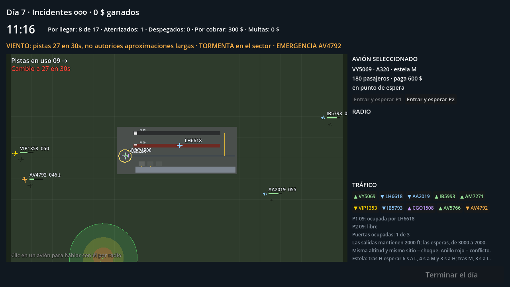
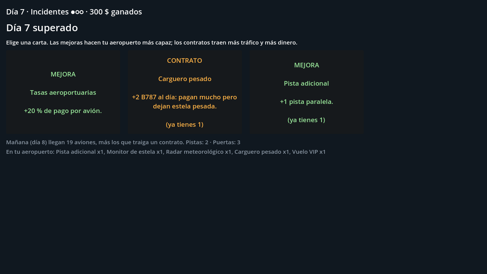
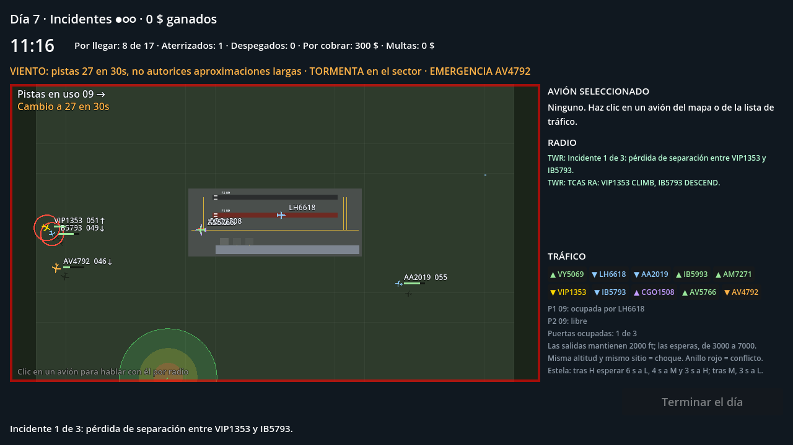
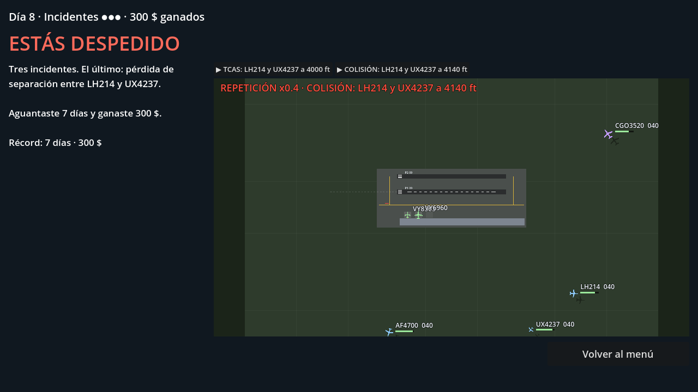

# Torre de control (prototipo roguelite)

Prototipo del MVP. Godot 4.4, GDScript y renderer Compatibility, para que exporte a web.

## Abrirlo

1. Instala [Godot 4.4](https://godotengine.org/download), la versión estándar (no hace falta la de .NET).
2. En el gestor de proyectos: **Importar**, elige `project.godot` de esta carpeta.
3. Pulsa F5 para jugar.

## La partida

Es un **roguelite de torre de control**: aguanta todos los días que puedas.

1. **Turno de 9:00 a 18:00** (unos 2-3 minutos reales). El tráfico llega en oleadas con **dos horas punta** (hacia las 10 y las 17) y cada día trae más aviones que el anterior.
2. **Resumen del día**: aterrizajes, despegues, incidentes, primas, multas y las **repeticiones** de los incidentes.
3. **Eliges 1 de 3 cartas**: siempre hay al menos una mejora y un contrato.
4. **Tres incidentes y te despiden.** Un incidente es un desvío por falta de combustible o un aviso TCAS (pérdida de separación). **Una colisión te despide en el acto.**

La puntuación es el dinero ganado y los días aguantados. Hay récord personal y **reto diario**: la semilla es la fecha, así que todos los jugadores reciben el mismo tráfico, el mismo clima y las mismas cartas ese día y pueden comparar resultados.



### Cartas

| Mejoras | Contratos (más tráfico, más dinero) |
| --- | --- |
| Puerta de embarque, Calles de rodaje, Salida rápida, Pista adicional | **Chárter**: +3 aviones al día, +25 % de pago |
| Controlador de tierra (push-back automático) | **Low cost**: +4 aviones con el combustible justo, +35 % de pago |
| Monitor de estela, Radar meteorológico, Reserva de combustible | **Carguero pesado**: +2 B787 al día, estela H |
| Tasas aeroportuarias (+20 % de pago), Delegado sindical (borra un incidente) | **Vuelo VIP**: paga x5 si aterriza en menos de 45 s |



### Lo que complica cada día

- **Tormentas** que cruzan el mapa. Dentro, los aviones gastan el doble de combustible. Con la tormenta encima de una pista no se puede despegar y quien intente aterrizar hace motor y al aire por cizalladura. El radar meteorológico muestra su trayectoria.
- **Cambio de viento**: el ATIS avisa con 15 s (30 s con radar meteorológico) y las pistas pasan de 09 a 27 o al revés. Las aproximaciones en curso abortan y las salidas ruedan a la otra cabecera.
- **Emergencias**: médica (combustible para 45 s, prima x3) y fallo de motor (prima x3 y la pista queda cerrada 10 s tras la toma).
- **MAYDAY por combustible**: cuando una llegada baja de 20 s de combustible se declara en emergencia y parpadea en rojo. La barra bajo cada indicativo muestra lo que le queda.
- **TCAS**: si dos aviones en vuelo se acercan demasiado a la misma altitud, los pilotos dejan de obedecer a la torre (uno sube y otro baja), el juego pasa a cámara lenta con alarma y cuenta como incidente. Queda grabado para verlo en la repetición.



### Órdenes de radio

Haz clic en un avión (en el mapa o en la lista de tráfico) para ver pasajeros, combustible y fase, y darle órdenes. El piloto colaciona cada orden.

| Avión | Recorrido | Tus órdenes |
| --- | --- | --- |
| Llegada | entra por el borde → espera en circuito → tramo base → final → toma → rodaje → puerta | **Mantener 3000-7000 ft**, **Aterrizar Pn** |
| Salida | puerta → push-back → punto de espera → alineado → despegue → sale del mapa a 2000 ft | **Push-back**, **Entrar Pn**, **Despegar** |

Reglas de siempre: una operación por pista, separación por estela (tras un H hay que esperar más), puertas limitadas, y misma altitud más mismo sitio es un choque. La automatización solo cubre tierra: aterrizajes, altitudes y despegues siempre son tuyos.



## Guardado

La partida se guarda al elegir carta (`user://run.json`); un turno a medias se reinicia al volver. Los récords van en `user://records.json`. El despido borra la partida guardada.

## Fondo del mapa

El tablero se dibuja por código. Si existe `assets/mapa.png` (1600×1000, mismo encuadre que el mundo del juego), se usa como fondo: ahí va la futura textura satelital.

## Estructura

| Archivo | Qué hace |
| --- | --- |
| `scripts/game.gd` | Autoload `Game`: simulación espacial, pistas y viento, estela, puertas, tormentas, emergencias, TCAS, cartas, incidentes, repeticiones, guardado y récords. Sin UI. |
| `scripts/main.gd` | Interfaz construida por código: menú, turno (mapa + radio), resumen, cartas y despido. Cámara lenta en los incidentes. |
| `scripts/map_view.gd` | Dibuja el tablero y reproduce las repeticiones a x0,4. |
| `tests/pacing_sim.gd` | Bots que juegan partidas completas con varias semillas para medir cuántos días aguantan. |
| `tests/ui_smoke.gd` | Recorre todas las pantallas forzando tormenta, viento, emergencias, TCAS y despido. |
| `tests/screenshots.gd` | Regenera las capturas de `docs/capturas`. |

Todos los números de balance están en las constantes al principio de `game.gd`.

## Pruebas

```
godot --headless --path . -s tests/pacing_sim.gd
godot --headless --path . -s tests/ui_smoke.gd
```

Resultado actual de los bots: aguantan unos 8 días de media (unos 30 minutos por partida) y suelen caer por saturación del espacio aéreo (TCAS y colisiones) cuando no quedan altitudes de espera libres. La velocidad de órdenes del bot apenas cambia el resultado: el límite es la capacidad de pistas y la elección de cartas. Los bots nunca se equivocan con las altitudes, así que un jugador real tendrá más incidentes; hay que confirmarlo con jugadores.

## Exportar a web (itch.io)

Proyecto, Exportar, Añadir, Web. Descarga las plantillas de exportación si te las pide. Sube el `.zip` a itch.io como juego HTML5.
